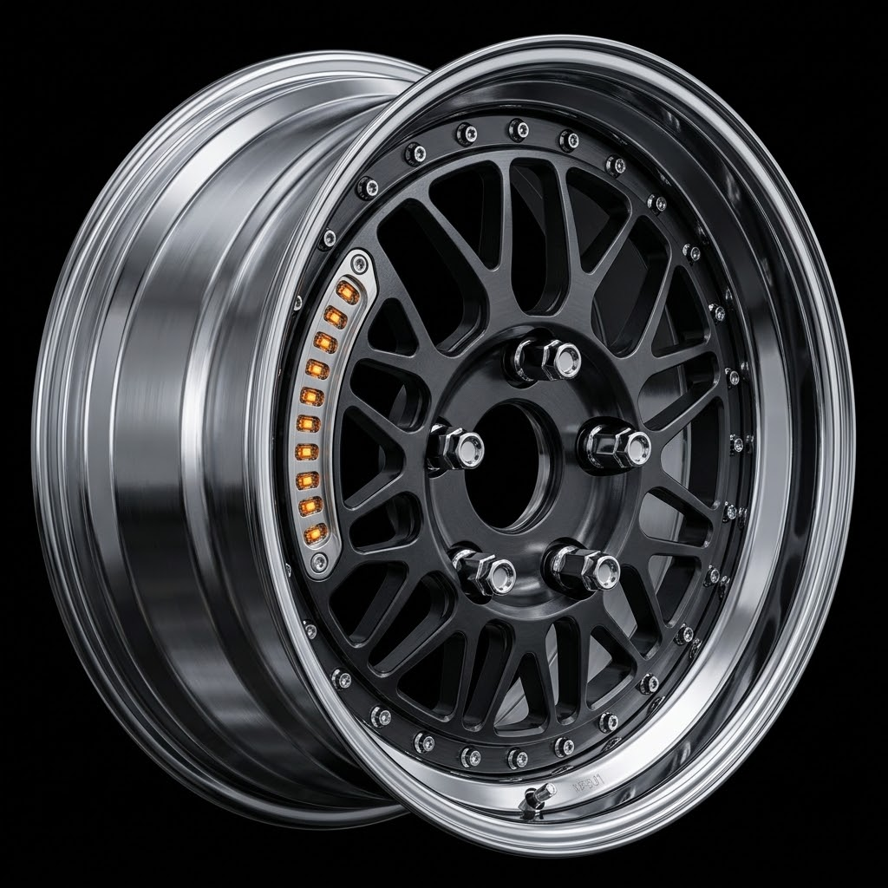

# NFS Underground on Mac



Launcher for **Need for Speed: Underground** (2003, PC, patch 1.4) on Apple Silicon. The game stays a 32-bit x86 Direct3D 9 binary. Wine runs it under Rosetta, and [mtld3d](https://github.com/athei/mtld3d) turns D3D9 into Metal. There is no OpenGL layer in between.

This is not a port and not a decompilation. You bring your own installed game. The original `Speed.exe` is never overwritten. A patched copy is written beside it as `Speed.exe.nfsu-mac`.

Tested on an M1: menu, garage, and races at 1440×900 with the in-game graphics options maxed, without frame drops. Motion blur stays off even if you turn it on in the settings. mtld3d does not apply `D3DBLEND_BLENDFACTOR`, and that quad would cover the frame.

**[Download NFS Underground.app](https://github.com/dmitriymolokov/nfsu-mac/releases/latest)**

## Play

1. Install your own US 1.4 game.
2. Put this unpatched no-cd [Speed.exe](https://drive.google.com/file/d/1uyobKyV3d4v-IZdqWik-YrlgGKQ2Juw7/view?usp=sharing) in your folder game. Replace original Speed.exe
3. Download and unzip `NFS Underground.app` next to that `Speed.exe`. 
4. Open the app, pick a resolution and a language, press Play. Only the English version has in-game movies.

The first launch unpacks Wine into `~/Library/Application Support/NFSUnderground/` and creates a prefix. Later launches reuse it.

If macOS refuses to open the app and keeps it in quarantine, clear the flag in Terminal:

```
xattr -dr com.apple.quarantine "/path/to/NFS Underground.app"
```

Replace `/path/to/` with the folder where you unzipped the app.

Resolutions are 16:10: 1024×640, 1280×800, 1440×900, 1680×1050, 1920×1200. Default is 1440×900.

Do not drop your own `d3d9.dll` into the game folder. It would replace the built-in mtld3d.

The window is 16:10 by itself. The race camera stays 4:3 unless the game folder also has ThirteenAG's widescreen fix: `dinput8.dll` and `scripts/NFSUnderground.WidescreenFix.asi`.

## Credits

- [athei](https://github.com/athei) — [mtld3d](https://github.com/athei/mtld3d) and the [wine-build](https://github.com/athei/wine-build) macOS archive inside the app. D3D9 goes to Metal there.
- [ThirteenAG](https://github.com/ThirteenAG/WidescreenFixesPack) — Widescreen Fix. The race camera still comes from `NFSUnderground.WidescreenFix.asi`.
- Wine — the process and the prefix.
- EA Black Box — *Need for Speed: Underground*. This project does not include the game, the executable, or any game data.

EA does not sell this title on Steam or GOG. Use an install you already have.
